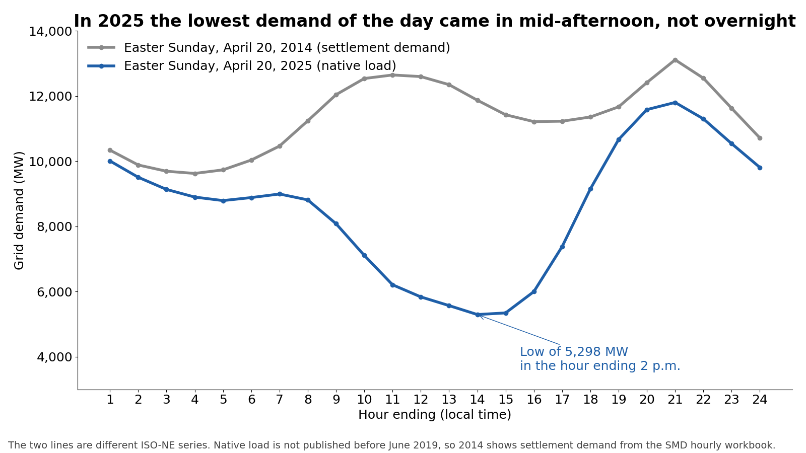
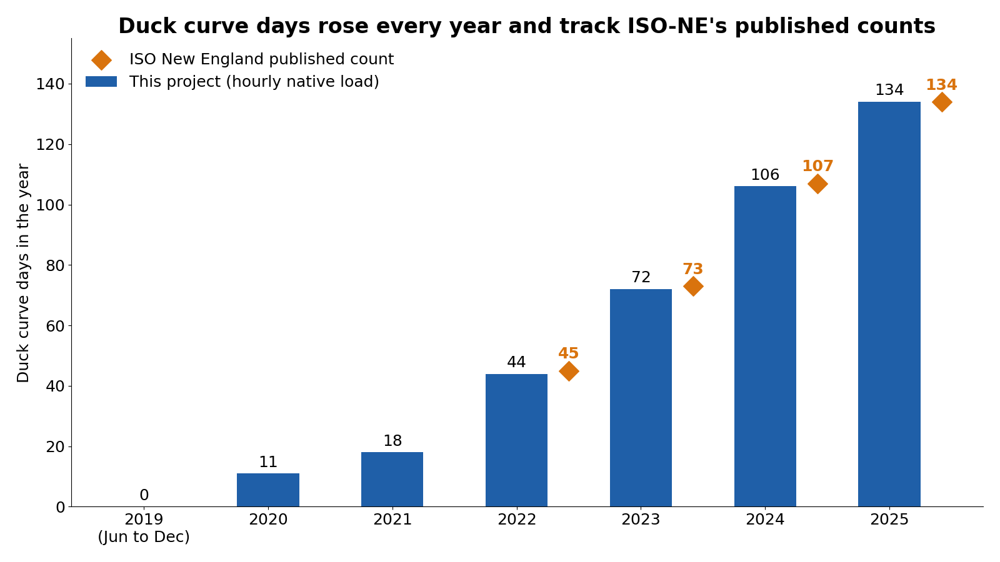

# Duck curve days in New England

On a growing number of days, New England's grid demand bottoms out in the middle of the afternoon instead of overnight. Rooftop solar that ISO New England can't see is serving local load, so the region looks like it needs less power at 1 p.m. than at 3 a.m. This project asks which conditions predict those days, and tests whether calendar, weather, and installed solar explain them better than chance.



This started as my capstone for the MS in Data Analytics at Western Governors University. It uses public data only.

## Definition

A duck curve day is a date whose lowest hourly native load falls in the hour ending 9 a.m. through the hour ending 5 p.m. Counted this way, the yearly totals land within one day of the counts ISO New England publishes:



The study period is June 1, 2019, the first day ISO-NE publishes hourly native load, through September 29, 2026: 2,678 days, of which 492 are duck curve days.

## Model and results

A logistic regression predicts whether each day is a duck curve day from month, day of week, holiday, daily high temperature, daytime sky cover, and installed behind-the-meter solar. It is trained on June 2019 through December 2024, tested once on 2025, and checked again on 2026 through September 29.

- **Hypothesis test:** a likelihood ratio test against an intercept-only model gives G = 865.2 on 21 degrees of freedom, p < 0.001. The predictors explain duck curve days far better than the base rate alone.
- **Solar:** each additional 1,000 MW of installed behind-the-meter solar multiplies the odds of a duck curve day by about 5.0 (95% CI 3.9–6.3).
- **Clouds:** each additional okta of daytime sky cover cuts the odds by about 61% (odds ratio 0.39, 95% CI 0.34–0.44).
- **Weekends:** Saturdays and Sundays have about 13 and 18 times the odds of a Monday, because business load is gone.
- **Season:** March, April, and May carry the highest odds, when solar output is strong and neither heating nor air conditioning props up midday load.

| Scored set | Days | Duck days | Accuracy | Always "not a duck day" | Recall | Precision |
|---|---|---|---|---|---|---|
| 2025 test year | 361 | 132 | 0.748 | 0.634 | 0.803 | 0.620 |
| 2026 holdout, through September 29 | 269 | 106 | 0.695 | 0.606 | 0.925 | 0.570 |

Two limits are worth knowing. Duck curve days cluster: after a duck curve day the next day is one about 49% of the time, against 12% after an ordinary day. The test assumes independent days, so its p-value is smaller than it should be. Installed solar also rises every year and the model has no separate time trend, so the solar coefficient absorbs anything else that changed steadily over the period.

The full output is in [`results/model_summary.txt`](results/model_summary.txt), with coefficients, predictions, and every reported number in the other files in `results/`.

## Data

- ISO New England hourly native load, from the ISO Express web services API (needs a free ISO Express account).
- NOAA Local Climatological Data for eight weather stations across the ISO-NE region, weighted as listed in `reference/isone_weather_station_weights.csv`.
- Installed behind-the-meter solar by year from ISO-NE's annual PV forecast reports, entered by hand in `reference/` with the page cited for each value.

Every downloaded file is logged with its source URL and checksum in `manifest/downloads.csv`. Raw and curated data stay out of git.

## Pipeline

The pipeline is PySpark. It runs locally or on AWS Glue, with the raw and curated layers in S3 and validation queries in Athena.

```
step0/      check the duck curve day definition against ISO-NE's published counts
step1/      first pandas build of the predictors, kept as a cross-check
pipeline/   PySpark jobs: clean load, clean weather, build the daily table, fit the model, make figures
reference/  hand-entered reference tables
manifest/   provenance log for every downloaded file
results/    model output, figures, and numbers
```

To run it locally, you need Python 3.10 or later and Java 17:

```bash
python3 -m venv .venv
source .venv/bin/activate
pip install -r requirements.txt
```

Then follow the job order in [`pipeline/README.md`](pipeline/README.md). The AWS steps are in [`pipeline/AWS_RUNBOOK.md`](pipeline/AWS_RUNBOOK.md).

## License

Code is Apache-2.0. See [LICENSE](LICENSE). ISO New England and NOAA data remain under their publishers' terms.
